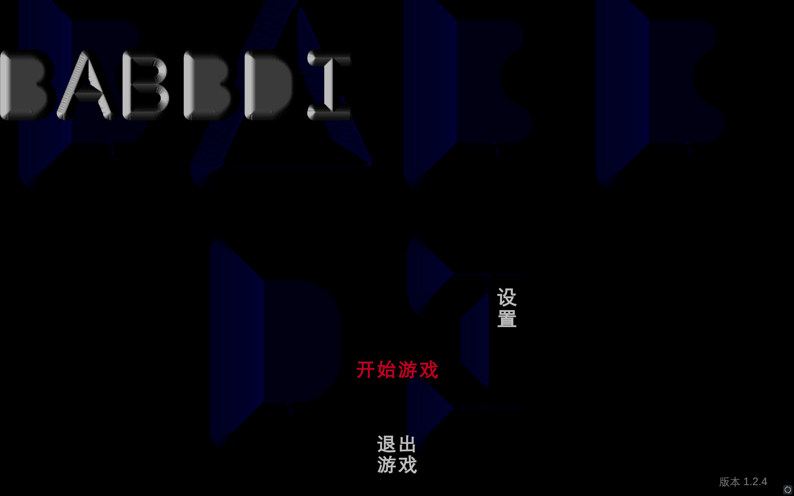

# BABBDI 简体中文汉化补丁

> 给 Steam 游戏 **BABBDI**（AppID 2240530）做的简体中文汉化，**一键安装、开箱即用**。
> 不需要网盘、不需要联网下载、不会覆盖或修改任何游戏原文件。

[](https://store.steampowered.com/app/2240530/BABBDI/)
[]()
[](LICENSE)



---

## 🚀 一键安装（30 秒搞定）

1. 点右上角 **Code → Download ZIP**，或者到 **[Releases](../../releases)** 下载打包好的版本
2. 把压缩包**解压**到任意位置（例如桌面）
3. 双击 **`一键安装汉化.bat`**

安装程序会自动找到你的 BABBDI 游戏目录，然后复制好全部文件。装完**直接从 Steam 启动游戏就是中文的**。

> **如果双击后 Windows 弹出蓝色的"Windows 已保护你的电脑"提示**
> 这是 Windows 对下载来的文件的默认保护，不是病毒。点「更多信息」→「仍要运行」即可。
> 或者更省事：**在解压之前**，右键下载的 ZIP → 属性 → 勾选底部的「解除锁定」→ 确定。

### 想还原成英文？

双击 **`一键还原英文.bat`**，几秒钟就恢复原版。

---

## ✨ 特性

| | |
|---|---|
| **纯离线** | 全部组件都已内置，**全程不需要联网**，国内网络环境也能一次装好 |
| **绿色无侵入** | 只往游戏目录里"新增"文件，**不修改、不替换、不删除任何游戏原文件** |
| **可随时还原** | 一键卸载，卸载后与 Steam「验证游戏文件完整性」完全兼容 |
| **人工翻译** | **187 条**译文逐条对照游戏内真实文本翻译，不是机翻凑数 |
| **解决字体难题** | 自带中文字体注入插件，不会出现"汉字显示成方框"的经典问题 |
| **自动适配** | 自动探测 Steam 游戏目录（多硬盘、多库都支持），找不到就弹窗让你选 |

安装后游戏目录只多出这些文件（约 **3.5 MB**）：

```
BABBDI/
├── winhttp.dll              ← BepInEx 注入器
├── doorstop_config.ini
├── .doorstop_version
└── BepInEx/                 ← 插件与汉化词典
```

---

## 📖 汉化内容

**已汉化（约 187 条）**

- **主菜单**：开始游戏 / 设置 / 退出游戏 / 返回 / 载入中 / 版本号
- **设置面板**：主音量 / 环境音 / 音乐 / 音效 / 操作设置 / 鼠标灵敏度 /
  反转鼠标 X、Y 轴 / 平滑头部动作 / 头部晃动与镜头倾斜 / 画质（低·中·高·极高）/ 速通模式
- **存档菜单**：保存游戏 / 重置存档 / 重置本轮 / 返回家中 / 退出到主菜单 / 游戏已保存 …
- **资料库（Library）全部任务与成就**：巴布迪任务、攀爬之路、速通之路、摩托之路、
  撩人之道、忧郁的离别、秘密大师、狗狗之友、平躺脸、社交任务，以及每条成就的达成条件
- **全部 59 句 NPC 对话**（含原文就是西班牙语的那几句）
- **全部交互提示**：开门 / 使用电梯 / 拾取 / 交谈 / 询问火车 / 开关，以及 `[e]` `[x]` 按键提示
- **各种弹窗**：成就已解锁 / 你发现了一件秘密物品 / 你找到了地图 / 你没有车票 …
- **道具名称**：车票 / 地图 / 球棒 / 手电筒 / 螺旋桨 / 吹叶机 / 寻尸器 …

**有意保留英文**

- **NPC 名字**（Amassou、Ivano、Griselda…）—— 人名保留原文
- 标题 art 上的 `BABBDI`、制作人员名单里的人名
- **3D 场景里贴在墙面上的文字**（招牌、涂鸦）—— 它们是"画"在贴图上的图片而不是文本，
  文本级汉化无法修改

---

## ❓ 常见问题

<details>
<summary><b>装完进游戏还是英文？</b></summary>

先看日志文件：`<游戏目录>\BepInEx\LogOutput.log`

- **日志文件不存在** → BepInEx 没加载成功。多半是 `winhttp.dll` 被杀毒软件删了，
  把它加进白名单后重新运行一次安装程序。
- **日志里有 `★ 中文字体创建成功`** → 汉化已生效，请确认你启动的是 Steam 里的 BABBDI。
</details>

<details>
<summary><b>汉字显示成方框（豆腐块）？</b></summary>

说明中文字体没加载成功。打开日志搜「中文字体创建成功」：

- 找不到 → 在 `BepInEx\config\babbdi.chinesefont.cfg` 里把 `FontFile` 手动指向一个中文字体文件，
  例如 `FontFile = C:\Windows\Fonts\simhei.ttf`

> ⚠️ 必须填**字体文件的完整路径**，不能只写字体名。
</details>

<details>
<summary><b>某处还是英文 / 某句译文不满意？</b></summary>

编辑 `BepInEx\Translation\zh-CN\Text\BABBDI_zh-CN.txt`，格式是 `英文原文=中文译文`，一行一条。

**改完不用重启游戏**：在游戏里按 **ALT + R** 即可热重载词典。

如果发现了漏翻的文本，也欢迎提 [Issue](../../issues) 告诉我原文。
</details>

<details>
<summary><b>想换一个中文字体？</b></summary>

编辑 `BepInEx\config\babbdi.chinesefont.cfg`：

```ini
FontFile = C:\Windows\Fonts\simhei.ttf
```

也可以直接把任意 `.ttf` / `.otf` / `.ttc` 字体文件丢进
`BepInEx\plugins\BabbdiChineseFont\` 目录，插件会优先使用它。

Windows 自带的中文字体文件：

| 字体 | 路径 |
|---|---|
| 等线（默认使用） | `C:\Windows\Fonts\Deng.ttf` |
| 黑体 | `C:\Windows\Fonts\simhei.ttf` |
| 楷体 | `C:\Windows\Fonts\simkai.ttf` |
| 仿宋 | `C:\Windows\Fonts\simfang.ttf` |
| 微软雅黑 | `C:\Windows\Fonts\msyh.ttc` |
</details>

<details>
<summary><b>汉化和这个游戏的其他 Mod 冲突吗？</b></summary>

本汉化基于 BepInEx 5，和其他同样基于 BepInEx 5 的 Mod 可以共存（各占一个插件目录）。
如果某个 Mod 也替换文本，可能会有优先级冲突，可以提 Issue 反馈。
</details>

<details>
<summary><b>Steam 提示"验证游戏文件完整性"会删掉汉化吗？</b></summary>

不会。汉化只是往游戏目录新增了文件，没有改动任何被 Steam 跟踪的原文件，
所以校验不会删除它们，校验后汉化依然有效。
</details>

---

## 🗑️ 卸载

双击 **`一键还原英文.bat`**，它会删除 `winhttp.dll`、`doorstop_config.ini`、
`.doorstop_version` 和 `BepInEx` 文件夹，游戏即回到英文原版。

---

## 🛠️ 技术实现

想了解原理或自己改的话，可以看看这两块：

### 1. 文本替换

用 [XUnity.AutoTranslator](https://github.com/bbepis/XUnity.AutoTranslator) 挂钩游戏文本，
配合本项目的**离线词典**（`payload/BepInEx/Translation/zh-CN/Text/BABBDI_zh-CN.txt`）替换成中文，
**不使用任何在线翻译接口**。

但 XUnity 是"挂钩式"的：只有经过文本赋值的文本才会被它处理。本作有大量标签是在场景加载时
就序列化好的（早于插件挂钩），于是本项目额外写了一个**补漏层**，主动扫描全部 TMP 文本组件
（含未激活对象）按词典补齐。

### 2. 中文字体（最难的一环）

游戏用 TextMeshPro，自带字体图集只有拉丁字形，直接显示汉字会是方框。
XUnity 自带的字体覆盖功能要求 TMP 3.2.0+，而本作 TMP 版本更低，用不了。
实测结论：

```csharp
// ❌ 拿不到字体文件路径 → FontEngine.LoadFontFace 失败
//    → TMP_FontAsset.CreateFontAsset 返回 null（所有系统字体都一样）
Font.CreateDynamicFontFromOSFont("SimHei", 90);

// ✅ 单参数构造函数会判断参数里有没有目录，有目录时走 Internal_CreateFontFromPath，
//    把真正的字体文件交给 FontEngine
new Font(@"C:\Windows\Fonts\Deng.ttf");
```

创建出的动态字体被注册为**游戏所有 TMP 字体资源的"回退字体"**：
英文数字继续用游戏原字体，只有汉字由中文字体补齐。
同时把译文用到的 359 个字符（汉字 + 全角标点 + 中文引号）一次性预热进图集。

### 3. 其他细节

- **打字机效果**：对话是逐字显示的，因此启用了 XUnity 的 `GeneratePartialTranslations`；
  副作用是"精确键的每个前缀都会被生成部分译文"，所以把 `BABBDI QUEST    :` 改写成正则条目，
  避免主菜单大标题 `BABBDI` 被误翻成"巴布"
- **短标签排版**：个别按钮的文本框很窄（"开始游戏"框宽 200px、需要 210px），
  中文会被硬拆成两行；插件对这类"只差一点点"的标签开启自动缩放，让它保持单行

---

## 📁 仓库结构

```
BABBDI-Chinese-Patch/
├── 一键安装汉化.bat            ← 双击这个安装
├── 一键还原英文.bat            ← 双击这个卸载
├── 说明-先看这个.txt           ← 纯文本快速上手
├── scripts/
│   ├── install.ps1            ← 安装逻辑（自动探测 Steam 路径、自检、非交互 -Yes）
│   └── uninstall.ps1
├── payload/                    ← 要复制进游戏目录的全部内容（自带组件，无需联网）
├── source/                     ← 源码，方便审计与二次开发
│   ├── plugin/                ← 中文字体注入插件（C#）
│   └── tools/                 ← 文本提取与词典生成脚本（Python）
├── third_party/                ← 第三方组件的许可证
└── docs/
```

---

## 🙏 致谢与许可

本项目的汉化词典、字体插件与安装脚本以 **MIT 许可证**发布（见 [LICENSE](LICENSE)）。

用到的第三方组件（均已内置在 `payload/`，遵循各自许可证）：

| 组件 | 作者 | 许可证 |
|---|---|---|
| [BepInEx](https://github.com/BepInEx/BepInEx) 5.4.23.5 | BepInEx Team | LGPL-2.1 |
| [XUnity.AutoTranslator](https://github.com/bbepis/XUnity.AutoTranslator) 5.6.2 | bbepis | MIT |
| [HarmonyX](https://github.com/BepInEx/HarmonyX) / [MonoMod](https://github.com/MonoMod/MonoMod) 等 | 各自作者 | MIT |

详见 [THIRD-PARTY-LICENSES.md](THIRD-PARTY-LICENSES.md)。

### 免责声明

- 本项目是**玩家自制的非官方汉化**，与游戏开发商 Lemaitre Bros 无关。
- 游戏本体、游戏文本与美术资源的一切权利归其原作者所有。
- 汉化需要读取并替换游戏内的文本字符串，这是所有文本汉化的通用做法。
- 本项目不包含任何游戏本体文件，**使用前请先在 Steam 购买/获取正版游戏**。

---

## 📜 版本

| 版本 | 说明 |
|---|---|
| v1.0.0 | 首版：187 条人工译文，覆盖菜单 / 设置 / 资料库 / 全部 NPC 对话 / 交互提示 / 道具名 |
